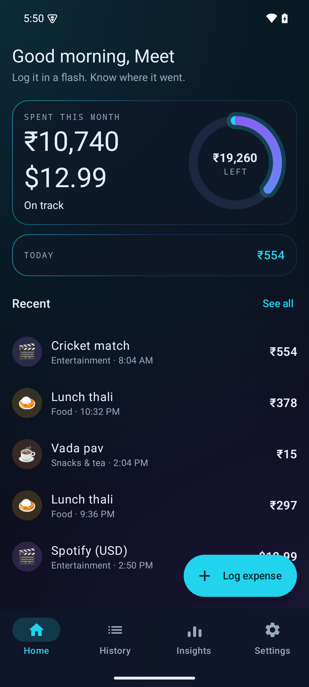
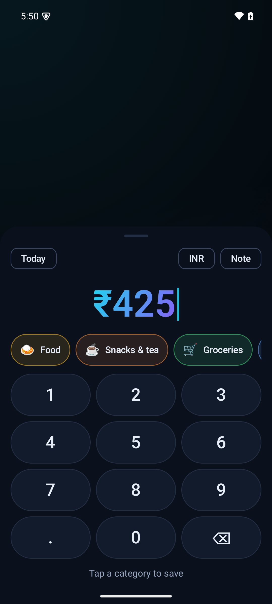
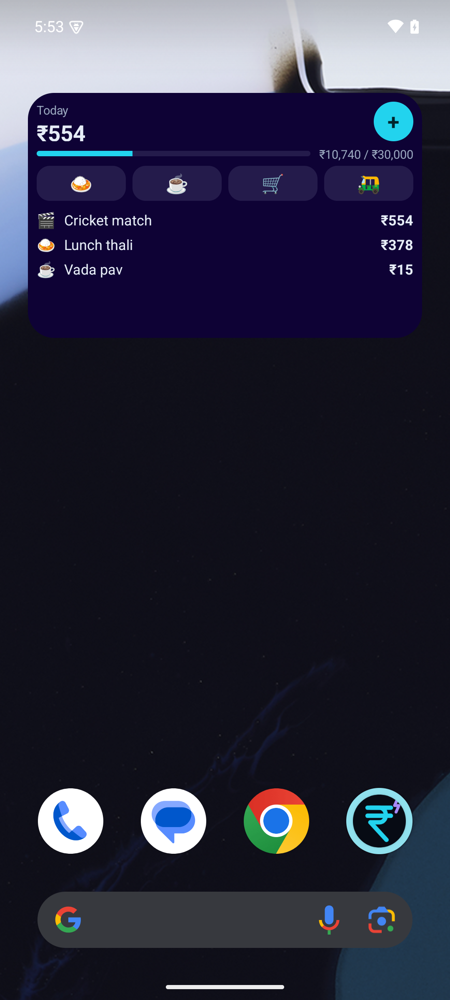
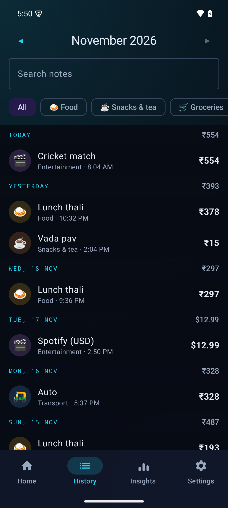
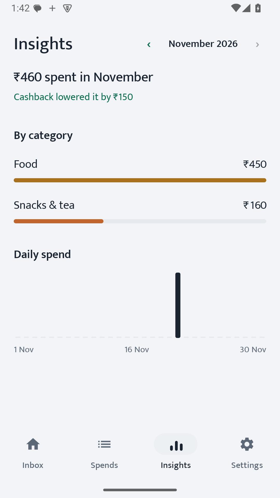
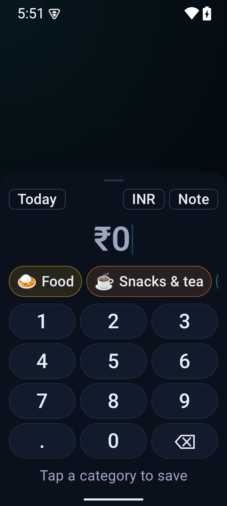

# Tapspend 🪙

**Log it in a flash. Know where it went.**

An open-source, offline-first Android expense tracker with one promise: **log an expense in under 3 seconds, without opening the app.**

|  |  |  |
|---|---|---|
|  |  |  |
|  |  |  |

## Why it's different

- **Fast.** Tap the home-screen widget → type the amount → tap a category. Done. The same sheet opens from a Quick Settings tile and a long-press app shortcut.
- **Private by construction.** The app has **no `INTERNET` permission**, so it physically cannot send your data anywhere. CI fails the build if that ever changes (`scripts/check-permissions.sh`).
- **Gentle on battery.** No services, no polling, no wake locks of our own. The widget refreshes only when your data changes, plus one non-wakeup alarm at midnight so "Aaj" resets.
- **Made for real life.** Indian digit grouping (₹1,00,000), salary-cycle months (start the month on any day 1–28), multi-currency with no conversion, and a futuristic dark-first design with neon accents.
- **Small.** About 3 MB release APK.

## Features

Quick Log sheet · widget (3 sizes) · QS tile · app shortcut · History with search, filters, swipe-to-delete + Undo · Insights (donut + daily bars, per-currency) · custom categories (emoji + colour, reorder, archive) · CSV export · password-encrypted JSON backup/restore · hide amounts on widget · secure screen · dark mode & dynamic colour · TalkBack-friendly.

## Install

**[⬇ Download the APK](https://github.com/MeetSoneji/tapspend/releases/latest/download/Tapspend.apk)** (always the latest release). Open it on your phone and allow "install unknown apps" for your browser or file manager once. Requires Android 8.0+.

Verify the download (optional): compare `sha256sum Tapspend.apk` with [Tapspend.apk.sha256](https://github.com/MeetSoneji/tapspend/releases/latest/download/Tapspend.apk.sha256). All releases: [Releases](../../releases).

## Build from source

```bash
git clone <this repo> && cd Tapspend
./gradlew :app:assembleDebug        # needs JDK 17 and the Android SDK (platform 35)
./gradlew :app:testDebugUnitTest    # 27 JVM unit tests
./scripts/check-permissions.sh      # after assembleRelease: permission allowlist
```

No keys, accounts or secrets are needed. Rebrand a fork by editing `app.config.properties` (id, name, tagline) and `app/src/main/assets/default_categories.json`.

## How it's built

Kotlin · Jetpack Compose + Material 3 · Room (SQLite, schema exported to `app/schemas/`) · Preferences DataStore · Jetpack Glance (widget) · Navigation Compose (type-safe routes) · Glance. Money is always a `Long` in minor units plus an ISO-4217 code, never a float. All totals are SQL `SUM … GROUP BY`. Architecture notes and trade-offs are in [`docs/adr/`](docs/adr).

## Privacy & security

See [PRIVACY.md](PRIVACY.md) and [SECURITY.md](SECURITY.md). Short version: no data collected, nothing leaves your device unless you export a file.

## Contributing

See [CONTRIBUTING.md](CONTRIBUTING.md). Licence: [Apache-2.0](LICENSE).
