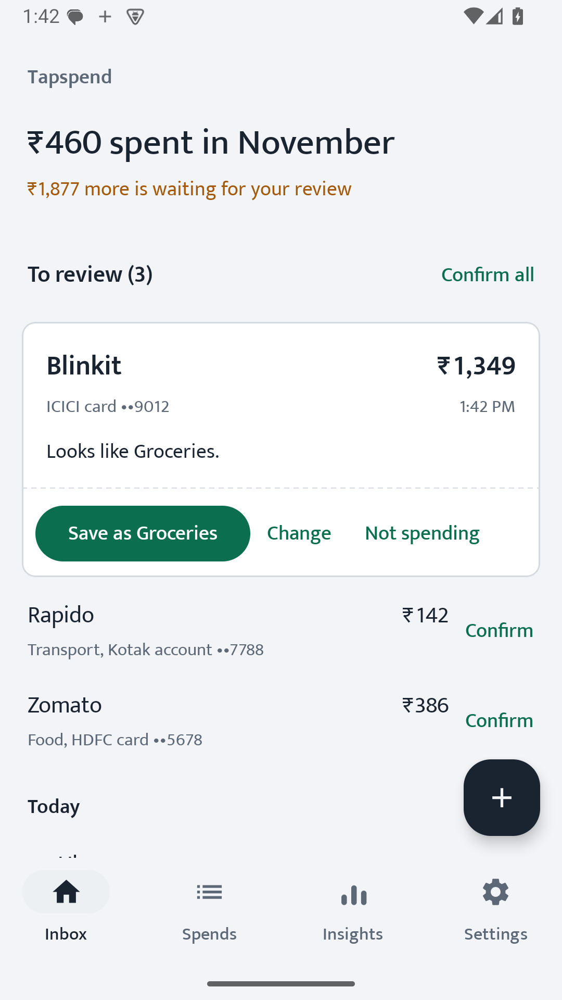
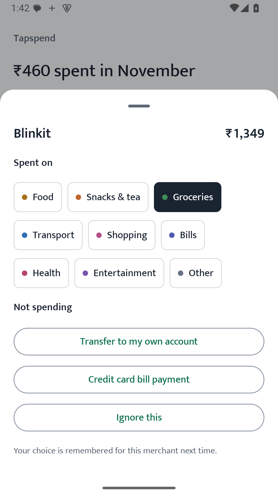
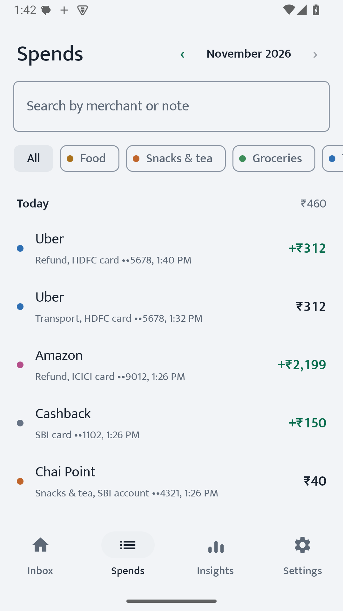
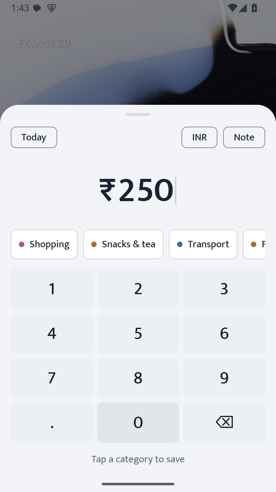
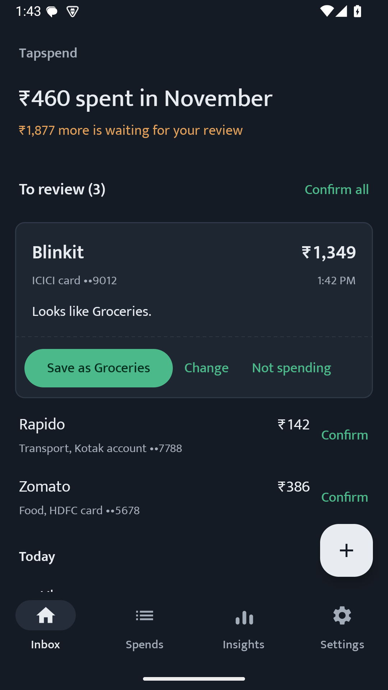

# Tapspend

**Every card and UPI payment, caught and sorted. You just confirm.**

Tapspend reads the bank and card alerts already arriving on your phone, works out what each payment was, and puts it in an inbox for a one-tap OK. Everything happens on the device: the app has no internet permission at all.

|  |  |  |
|---|---|---|
|  |  |  |
|  |  |  |

## Install

**[Download the APK](https://github.com/MeetSoneji/tapspend/releases/latest/download/Tapspend.apk)** (always the latest release). Open it on your phone and allow "install unknown apps" for your browser or file manager once. Android 8.0 or newer.

Optional check: compare `sha256sum Tapspend.apk` with [Tapspend.apk.sha256](https://github.com/MeetSoneji/tapspend/releases/latest/download/Tapspend.apk.sha256).

## How it works

1. **A payment happens.** Your bank sends its usual SMS, or your UPI app shows a notification.
2. **Tapspend reads it on the phone** and works out the amount, the card or account, the merchant, and a likely category ("Swiggy" is Food, "Rapido" is Transport).
3. **You confirm it** from the notification or the inbox: *Save as Food*, *Change*, or *Not spending*. If you don't answer, it waits in the inbox and a daily reminder (at a time you pick) nudges you.
4. **It learns.** Change a merchant's category once and it is pre-filled correctly next time.

On first run it can import the last 90 days of bank alerts, so you start with history, not an empty screen.

## Credit cards, refunds and transfers

- **A card swipe is the spend**, dated the day you swiped. Paying the card bill later (via CRED, net banking, or "payment received on your card") is recognised as **not spending**, so nothing is counted twice.
- **Self-transfers** are not spending: money leaving one of your accounts and arriving in another within minutes, payments to your own name, wallet top-ups, investments and ATM withdrawals.
- **Cashback and reward credits** lower that month's spend, in the month they post.
- **Refunds** with an alert are matched to the purchase's category. Refunds that arrive silently can be added with **Mark refunded** on any spend.
- Coming next: a per-card statement check that compares your swipes, refunds and cashback with the statement amount and points out anything missing.

## Privacy

- **No internet permission.** The app cannot send data anywhere. CI fails the build if that ever changes (`scripts/check-permissions.sh`).
- Messages are parsed on the phone. Only the amount, merchant, card or account (last 4 digits), time and reference number are kept; the message text is not stored.
- Only bank sender IDs (like `VM-HDFCBK`) are read. Personal messages are skipped.

See [PRIVACY.md](PRIVACY.md) for every permission and why it is needed.

## Build from source

```bash
git clone https://github.com/MeetSoneji/tapspend && cd tapspend
./gradlew :app:assembleDebug        # JDK 17 + Android SDK (platform 35)
./gradlew :app:testDebugUnitTest    # parser, classifier, money, backup tests
```

Kotlin, Jetpack Compose, Room, DataStore, Glance. Type: [Mukta](https://fonts.google.com/specimen/Mukta) by Ek Type (SIL OFL, see `docs/FONT-LICENSE-Mukta.txt`). Design decisions are recorded in [`docs/adr/`](docs/adr).

## Contributing

See [CONTRIBUTING.md](CONTRIBUTING.md). Sample bank messages (with numbers masked) that Tapspend misreads are the most useful contribution: add them as test cases in `CaptureTest.kt`. Licence: [Apache-2.0](LICENSE).
